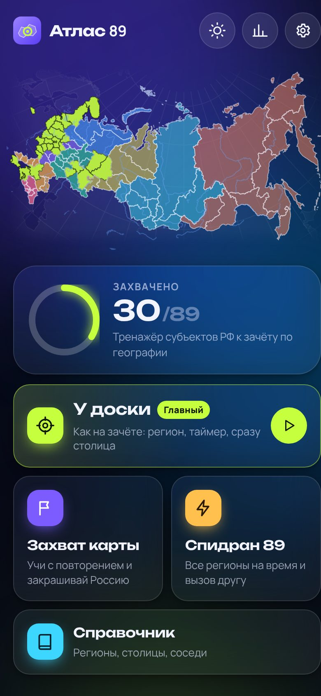
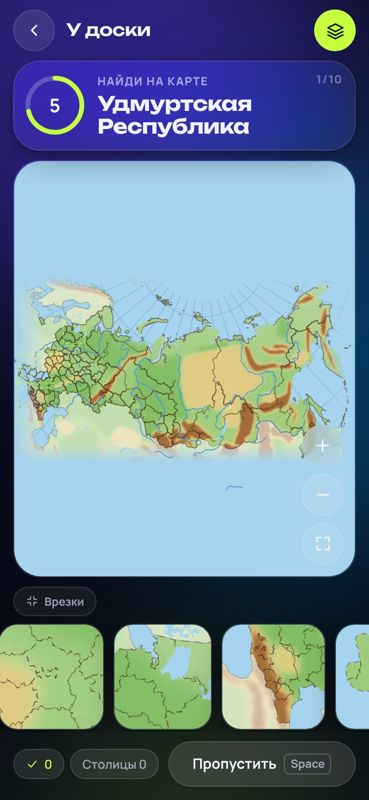
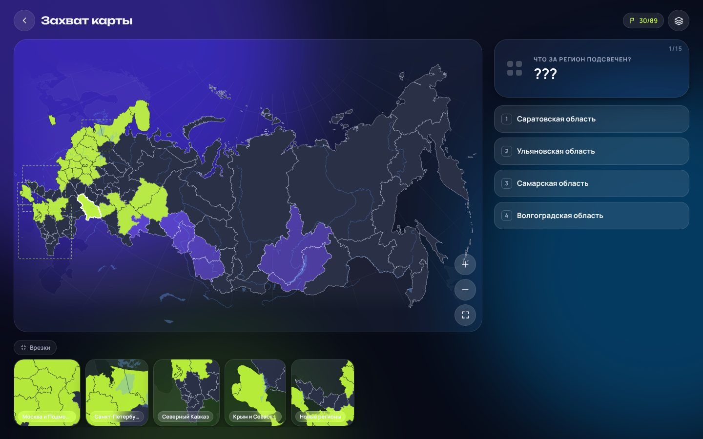
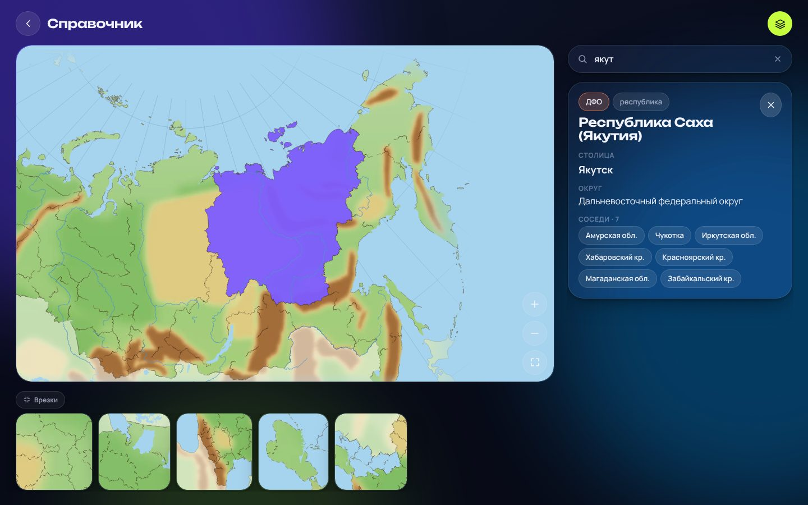

# Атлас 89

Тренажёр к школьному зачёту по географии: найди на карте любой из **89 субъектов РФ** и сразу назови его **столицу**. Как у доски, только с телефона.

**Сайт:** https://kirillkaurov3-cloud.github.io/atlas89/

<p>
  
  
</p>
<p>
  
  
</p>

## Что умеет

- **«У доски»** — точная имитация зачёта: учитель называет регион, идёт таймер (5/7/10 с), нашёл — сразу «Назови столицу» (4 варианта из того же округа или ввод с клавиатуры). Не успел — пропуск, камера показывает, где был регион. В конце — точность, среднее время и «Повторить ошибки».
- **«Захват карты»** — учёба с интервальным повторением (система Лейтнера). Серая карта постепенно закрашивается: регион «захвачен», когда ты 4 раза с перерывами верно назвал и место, и столицу. Можно учить по одному федеральному округу.
- **«Спидран 89»** — все регионы на время, ошибка +5 с. Кнопка **«Бросить вызов»** даёт ссылку: друг пройдёт **тот же порядок** и увидит, кто быстрее. Сервер не нужен.
- **«Справочник»** — карта с поиском (понимает «ХМАО», «Югра», «Якутия», столицы), карточка региона и соседи.
- Режим карты **«Как на доске»**: физическая карта без подписей с еле заметными границами, как на настоящем зачёте.
- Мелкие регионы: зум и перетаскивание, **врезки** (Москва, Петербург, Кавказ, Крым, новые регионы) и **расширенная зона касания**.
- 18 ачивок, статистика, серия дней, «самые сложные регионы», экспорт и импорт прогресса.
- Тёмная и светлая темы, работает на телефоне одной рукой, можно установить на экран как приложение.

Прогресс хранится **только в браузере** (localStorage). Чтобы перенести его на другое устройство: «Настройки → Экспорт в файл», потом «Импорт из файла».

## Запуск у себя

Нужен [Node.js](https://nodejs.org) 20 или новее.

```bash
npm install
npm run dev
```

Откроется адрес вида `http://localhost:5173`. Сборка: `npm run build` (перед сборкой автоматически запускается проверка карты).

## Публикация на GitHub Pages

Уже настроено: каждый push в ветку `main` запускает workflow **«Деплой на GitHub Pages»** (`.github/workflows/deploy.yml`). Он ставит зависимости, проверяет, что на карте ровно 89 субъектов, собирает сайт и публикует его. Адрес (`base` в Vite) подстраивается под имя репозитория сам.

Если делаешь копию в своём репозитории: **Settings → Pages → Source: GitHub Actions**.

Ход сборки виден во вкладке **Actions**. Зелёная галочка значит, что сайт обновился (иногда нужно 1–2 минуты и обновить страницу).

## Как включить таблицу лидеров

Таблица лидеров уже встроена, но выключена. Пока ключей нет, её не видно и сайт работает без сервера. Чтобы включить, нужен бесплатный аккаунт Supabase и два «секрета» в GitHub. Код менять не нужно.

### 1. Создай проект в Supabase

1. Открой https://supabase.com и нажми **Start your project**. Войти проще всего через **GitHub**.
2. Нажми **New project**.
   - **Name:** `atlas89`
   - **Database Password:** придумай и **сохрани** (понадобится, только если будешь что-то делать с базой вручную).
   - **Region:** ближайший, например *Central EU (Frankfurt)*.
   - План — **Free**.
3. Нажми **Create new project** и подожди 1–2 минуты, пока проект создаётся.

### 2. Создай таблицу

1. Слева открой **SQL Editor** и нажми **New query**.
2. Открой в репозитории файл [`supabase/schema.sql`](supabase/schema.sql), скопируй **весь** текст и вставь в редактор.
3. Нажми **Run** (или Ctrl+Enter). Внизу должно появиться **Success. No rows returned**.

Скрипт создаёт таблицу `scores` и защиту:
- **читать** могут все;
- **анонимно** можно только **добавлять** результат, менять и удалять нельзя;
- проверки: ник 2–20 символов, спидран не быстрее 40 секунд, точность 0–100%;
- защита от спама: один ник не чаще раза в 20 секунд, с одного IP не больше 10 записей за 10 минут.

Скрипт можно запускать повторно, он ничего не сломает.

### 3. Скопируй URL и ключ

1. Слева внизу нажми **Project Settings** (шестерёнка).
2. Раздел **Data API** (или **API**): скопируй **Project URL**, он выглядит как `https://abcdefgh.supabase.co`.
3. Раздел **API Keys**: скопируй ключ **anon public** (длинная строка, начинается с `eyJ…`). Если в интерфейсе есть только новый **Publishable key** (`sb_publishable_…`), подойдёт и он.

> Это **публичный** ключ: он и так попадает в код сайта, это нормально. Данные защищены правилами из `schema.sql`. **Никогда** не вставляй ключ `service_role` / `secret`!

### 4. Добавь секреты в GitHub

1. Открой репозиторий на GitHub, затем **Settings → Secrets and variables → Actions**.
2. Нажми **New repository secret**:
   - **Name:** `VITE_SUPABASE_URL`, **Secret:** Project URL из шага 3 → **Add secret**.
3. Ещё раз **New repository secret**:
   - **Name:** `VITE_SUPABASE_ANON_KEY`, **Secret:** ключ из шага 3 → **Add secret**.

(Вместо секретов можно завести **Variables** с теми же именами, workflow понимает оба варианта.)

### 5. Перезапусти деплой

1. Вкладка **Actions** → слева **«Деплой на GitHub Pages»** → кнопка **Run workflow** → **Run workflow**.
2. Дождись зелёной галочки и открой сайт. В «Спидране» появится кнопка **«Таблица лидеров»**, а после забега результат с ником отправится в таблицу.

Проверить локально: скопируй `.env.example` в `.env.local`, впиши те же значения и запусти `npm run dev`.

### Важно: бесплатный проект Supabase «засыпает»

Если в проект **неделю** никто не заходил, Supabase ставит его на паузу (**Paused**). Сам сайт при этом работает, просто таблица лидеров показывает «Не удалось загрузить».

Как разбудить:
1. Зайди на https://supabase.com/dashboard и открой проект `atlas89`.
2. Нажми **Restore project** и подожди несколько минут.

Данные при паузе **не теряются**. Пока ребята активно играют, проект не уснёт.

Выключить таблицу обратно: удали оба секрета и перезапусти деплой (шаг 5).

## Данные карты

| Что | Откуда |
| --- | --- |
| 85 субъектов | [hairymax/offline_russia_plotly](https://github.com/hairymax/offline_russia_plotly), данные © участники [OpenStreetMap](https://www.openstreetmap.org/copyright) (ODbL) |
| ДНР, ЛНР, Запорожская и Херсонская обл. | [Natural Earth](https://www.naturalearthdata.com/) admin-1 (общественное достояние) |
| Соседние страны, озёра, реки, формы рельефа | Natural Earth |

Готовая геометрия уже лежит в репозитории (`src/data/regions.svg.json`, `context.svg.json`, `public/relief.webp`). Пересобирать её нужно, только если хочешь что-то поменять:

```bash
npm run map:fetch    # скачать исходники в scripts/.cache
npm run map:build    # склейка, упрощение (mapshaper), проекция, соседи + проверка
npm run map:relief   # растр рельефа для «Как на доске» (нужен Playwright/Chromium)
npm run validate     # проверка: ровно 89 субъектов, все сопоставлены со справочником
```

- **Проекция:** равновеликая коническая (как в школьных атласах), центральный меридиан 100° в. д., стандартные параллели 52° и 64°. Чукотка за 180-м меридианом не разрывается.
- **Справочник субъектов** (названия, столицы, округа, варианты написания) — `src/data/regions.ts`, это источник правды. Скрипт `validate` падает, если геометрия с ним не совпадает.
- **Спорные столицы** (Московская, Ленинградская, Запорожская, Херсонская обл.) переключаются в настройках, второй вариант тоже засчитывается.

## Устройство проекта

```
src/
  data/          справочник субъектов и подготовленная геометрия
  map/           карта: зум/пан, врезки, выбор мелких регионов, стили
  modes/         режимы: board («У доски»), capture, speedrun
  screens/       главная, справочник, статистика, настройки, лидеры
  lib/           хранилище с версией схемы, Лейтнер, ачивки, события
  leaderboard/   LeaderboardService: Noop (по умолчанию) и Supabase
scripts/         подготовка и проверка данных карты
supabase/        schema.sql для таблицы лидеров
```

Стек: Vite, React, TypeScript, Framer Motion, CSS Modules. Название приложения задаётся в одном месте, в `src/config.ts`.
